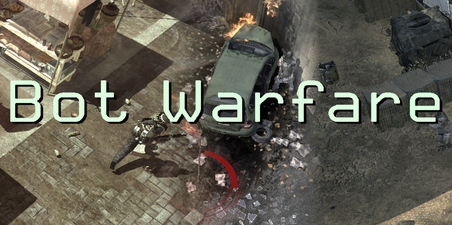

# IW5 Bot Warfare
Bot Warfare is a GSC mod for the [PlutoniumIW5 project](https://plutonium.pw/).

It aims to add playable AI to the multiplayer games of Modern Warfare 3.

You can find the ModDB release post [here](https://www.moddb.com/mods/bot-warfare/downloads/iw5-bot-warfare-latest).

## Contents
- [Features](#Features)
- [Installation](#Installation)
- [Documentation](#Documentation)
- [Changelog](#Changelog)
- [Credits](#Credits)

## Features
- A Waypoint Editor for creating and modifying bot's waypoints of traversing the map. Have a look at [Using the Waypoint editor](/bw-assets/wpedit.md).

- A clean and nice menu, you can edit every bot DVAR within in-game.

- Everything can be customized, ideal for both personal use and dedicated servers. Have a look at [Documentation](#Documentation) to see whats possible!

- This mod does not edit ANY stock .gsc files, meaning EVERY other mod is compatible with this mod. Mod doesn't add anything unnecessary, what you see is what you get.

- Adds AI clients to multiplayer games to simulate playing real players. (essentially Combat Training for MW3)
  - Bots move around the maps with native engine input. (all normal maps, most to all custom maps)
  - Bots press all the buttons with native engine input (ads, sprint, jump, etc)
  - Bots play all gamemodes/objectives, they capture flags, plant, defuse bombs, etc. (all gamemodes modes)
  - Bots use all killstreaks. Including AC130 and osprey gunner, etc.
  - Bots target killstreaks, use stingers and other weapons to take out all killstreaks. (even sentry guns)
  - Bots can capture and steal care packages.
  - Bots target equipment, and can even camp TIs.
  - Bots can camp randomly or when about to use the laptop.
  - Bots can follow others on own will.
  - Bots have smooth and realistic aim.
  - Bots respond smartly to their surroundings, they will go to you if you shoot, uav, etc.
  - Bots use all deathstreaks, perks and weapons. (including javelin)
  - Bots difficulty level can be customized and are accurate. (hard is hard, easy is easy, etc.)
  - Bots each all have different classes, traits, and difficulty and remember it all.
  - Bots switch from between primaries and secondaries.
  - Bots can grenade, place claymores and TIs, they even use grenades and tubes in preset map locations.
  - Bots use grenade launchers and shotgun attachments.
  - Bots can melee people and sentry guns.
  - Bots can run!
  - Bots can climb ladders!
  - Bots jump shot and drop shot.
  - Bots detect smoke grenades, stun grenades, flashed and airstrike slows.
  - Bots will remember their class, killstreak, skill and traits, even on multiround based gametypes.
  - Bots can throwback grenades.
  - ... And pretty much everything you expect a Combat Training bot to have

## Installation
0. Make sure that [PlutoniumIW5](https://plutonium.pw/docs/install/#iw5) is installed, updated and working properly.
    - Download the [latest release](https://github.com/ineedbots/iw5_bot_warfare/releases) of Bot Warfare.
1. Extract all the files from the Bot Warfare release archive you downloaded to anywhere on your computer.
2. Run the 'install.bat'. This copies the mod to your PlutoniumIW5 storage folder.
3. The mod is now installed, now run your game.
4. The mod should be loaded! Now go start a map and play!

## Documentation

### Menu Usage
- You can open the menu by pressing the Action Slot 1 key (default 'N', nightvision key).

- You can navigate the options by pressing your movement keys (default WASD), and you can select options by pressing your jump key (default SPACE).

- Pressing the menu button again closes menus.

### DVARs
| Dvar                             | Description                                                                                 | Default Value |
|----------------------------------|---------------------------------------------------------------------------------------------|--------------:|
| bots_main                        | Enable this mod.                                                                            | 1             |
| bots_main_firstIsHost            | The first player to connect will be given host.                                             | 0             |
| bots_main_GUIDs                  | A comma separated list of GUIDs of players who will be given host.                          |               |
| bots_main_waitForHostTime        | How many seconds to wait for the host player to connect before adding bots to the match.    | 10            |
| bots_main_menu                   | Enable the in-game menu for hosts.                                                          | 1             |
| bots_main_debug                  | Enable the in-game waypoint editor at start of the game, or enable bot event prints. <ul><li>`0` - disable</li><li>`1` - for just debug events</li><li>`2` - for every event</li><ul> | 0 |
| bots_main_kickBotsAtEnd          | Kick the bots at the end of a match.                                                        | 0             |
| bots_main_chat                   | The rate bots will chat at, set to 0 to disable.                                            | 1.0           |
| bots_manage_add                  | Amount of bots to add to the game, once bots are added, resets back to `0`.                 | 0             |
| bots_manage_fill                 | Amount of players/bots (look at `bots_manage_fill_mode`) to maintain in the match.          | 0             |
| bots_manage_fill_mode            | `bots_manage_fill` players/bots counting method.<ul><li>`0` - counts both players and bots.</li><li>`1` - only counts bots.</li><li>`2` - exactly `0` but auto adjusts `bots_manage_fill` to map.</li><li>`3` - exactly `1` but auto adjusts `bots_manage_fill` to map.</li><li>`4` - bots are used for balancing teams.</li><li>`5` - exactly `4` but auto adjusts `bots_manage_fill` to map.</li></ul> | 0 |
| bots_manage_fill_watchplayers    | Bots will not be added until one player is in the game                                      | 0             |
| bots_manage_fill_kick            | If the amount of players/bots in the match exceeds `bots_manage_fill`, kick bots until no longer exceeds. | 0 |
| bots_manage_fill_spec            | If when counting players for `bots_manage_fill` should include spectators.                  | 1             |
| bots_team                        | One of `autoassign`, `allies`, `axis`, `spectator`, or `custom`. What team the bots should be on. | autoassign |
| bots_team_amount                 | When `bots_team` is set to `custom`. The amount of bots to be placed on the axis team. The remainder will be placed on the allies team. | 0 |
| bots_team_force                  | If the server should force bots' teams according to the `bots_team` value. When `bots_team` is `autoassign`, unbalanced teams will be balanced. This dvar is ignored when `bots_team` is `custom`. | 0 |
| bots_team_mode                   | When `bots_team_force` is `1` and `bots_team` is `autoassign`, players/bots counting method. <ul><li>`0` - counts both players and bots.</li><li>`1` - only counts bots</li></ul> | 0 |
| bots_skill                       | Bots' difficulty.<ul><li>`0` - Random difficulty for each bot.</li><li>`1` - Easiest difficulty for all bots.</li><li>`2` to `6` - Between easy and hard difficulty for all bots.</li><li>`7` - The hardest difficulty for all bots.</li><li>`8` - custom (look at the `bots_skill_<team>_<difficulty>` dvars)</li><li>`9` - Every difficulty parameter is randomized</li></ul> | 0 |
| bots_skill_axis_hard             | When `bots_skill` is set to `8`, the amount of hard difficulty bots to set on the axis team. | 0            |
| bots_skill_axis_med              | When `bots_skill` is set to `8`, the amount of medium difficulty bots to set on the axis team. The remaining bots on the team will be set to easy difficulty. | 0 |
| bots_skill_allies_hard           | When `bots_skill` is set to `8`, the amount of hard difficulty bots to set on the allies team. | 0          |
| bots_skill_allies_med            | When `bots_skill` is set to `8`, the amount of medium difficulty bots to set on the allies team. The remaining bots on the team will be set to easy difficulty. | 0 |
| bots_skill_min                   | The minimum difficulty level for the bots.                                                     | 1          |
| bots_skill_max                   | The maximum difficulty level for the bots.                                                     | 7          |
| bots_loadout_reasonable          | If the bots should filter bad performing create-a-class selections.                            | 0          |
| bots_loadout_allow_op            | If the bots should be able to use overpowered and annoying create-a-class selections.          | 1          |
| bots_loadout_rank                | What rank to set the bots.<ul><li>`-1` - Average of all players in the match.</li><li>`0` - All random.</li><li>`1` or higher - Sets the bots' rank to this.</li></ul> | -1 |
| bots_loadout_prestige            | What prestige to set the bots.<ul><li>`-1` - Same as host player in the match.</li><li>`-2` - All random.</li><li>`0` or higher - Sets the bots' prestige to this.</li></ul> | -1 |
| bots_play_move                   | If the bots can move.                                                                          | 1          |
| bots_play_knife                  | If the bots can knife.                                                                         | 1          |
| bots_play_fire                   | If the bots can fire.                                                                          | 1          |
| bots_play_nade                   | If the bots can grenade.                                                                       | 1          |
| bots_play_take_carepackages      | If the bots can take carepackages.                                                             | 1          |
| bots_play_obj                    | If the bots can play the objective.                                                            | 1          |
| bots_play_camp                   | If the bots can camp.                                                                          | 1          |
| bots_play_jumpdrop               | If the bots can jump/drop shot.                                                                | 1          |
| bots_play_target_other           | If the bots can target other entities other than players.                                      | 1          |
| bots_play_killstreak             | If the bots can call in killstreaks.                                                           | 1          |
| bots_play_ads                    | If the bots can aim down sights.                                                               | 1          |
| bots_play_aim                    | If the bots can aim.                                                                           | 1          |
| bots_behavior_strafe             | Overrides the percent chance bots strafe while fighting. `-1` uses the bot's difficulty value.  | -1         |
| bots_behavior_nade               | Overrides the percent chance bots use grenades. `-1` uses the bot's difficulty value.          | -1         |
| bots_behavior_sprint             | Overrides the percent chance bots sprint. `-1` uses the bot's difficulty value.                | -1         |
| bots_behavior_camp               | Overrides the percent chance bots camp. `-1` uses the bot's difficulty value.                  | -1         |
| bots_behavior_follow             | Overrides the percent chance bots follow others. `-1` uses the bot's difficulty value.         | -1         |
| bots_behavior_crouch             | Overrides the percent chance bots crouch at each waypoint. `0` never, `100` always. `-1` uses the bot's difficulty value. (for crouch only bots, use `bots_play_stance`) | -1 |
| bots_behavior_switch             | Overrides the percent chance bots switch weapons. `-1` uses the bot's difficulty value.        | -1         |
| bots_behavior_class              | Overrides the percent chance bots change class on spawn. `-1` uses the bot's difficulty value. | -1         |
| bots_behavior_jump               | Overrides the percent chance bots jump/drop shot. `-1` uses the bot's difficulty value.        | -1         |
| bots_play_stance                 | Forces the bots to only use one stance: `stand`, `crouch` or `prone` (ex. `crouch` for crouch only bots). Bots won't sprint unless it is `stand`, and still stand to climb ladders. Anything else is normal. | none |
| bots_play_recoil                 | How much weapon recoil affects the bots' aim. Recoil builds up while firing full auto, easier bots control it worse. `0` disables recoil. | 1.0 |
| bots_skill_dynamic               | Changes the bots' difficulty during the match. Ignored when `bots_skill` is `8` or `9`.<ul><li>`0` - disabled.</li><li>`1` - by the amount of human players (look at `bots_skill_dynamic_players`).</li><li>`2` - each bot adapts to its own KDR, the worse a bot does the harder it gets (up to 3 levels either way).</li></ul> | 0 |
| bots_skill_dynamic_players       | When `bots_skill_dynamic` is `1`. Comma separated difficulties for 1, 2, 3... human players, the last value is used for any more players. | 2,2,2,4,4,4,4,7 |
| bots_main_xp_kill                | Multiplier of the kill XP human players get for killing a bot (bonuses like headshots are not affected). `0` gives no kill XP. | 1.0 |
| bots_main_xp_weapon              | Multiplier of the weapon XP human players get for killing a bot. `0` gives no weapon XP.       | 1.0        |

## Changelog
- Unreleased
  - Fixed bots not using some killstreaks (ex. after dying) because they did not hold the selected killstreak's weapon
  - Bots camp before using ride killstreaks earned this life again (was reading the wrong killstreak slot)
  - Fixed bots' third person scoped aim being offset with snipers that are not the 'sniper' weaponclass (ex. Dragunov)
  - Bots treat all sniper rifles (ex. Dragunov) as snipers
  - Bots' aim in third person uses setplayerangles again (as in v2.2.0)
  - Fixed bots always having at least a 1% chance to crouch, even when the crouch behavior is 0
  - Added bots_behavior_* dvars to override the bots' behavior values
  - Added bots_play_stance dvar to force bots into one stance (ex. crouch only)
  - Bots are affected by weapon recoil (bots_play_recoil)
  - Added bots_skill_dynamic and bots_skill_dynamic_players dvars, bot difficulty by amount of players or by KDR
  - Added bots_main_xp_kill and bots_main_xp_weapon dvars to scale the XP for killing bots
  - Fixed two unreachable waypoints on Erosion
  - Fixed the game crashing ("Couldn't find tag_player on player's view-link parent") on Osprey Gunner killcams: those kills skip the killcam and never become the final killcam

- v2.3.0
  - Fixed bots aiming in ac130/chopper being broken at times
  - Bots properly use pred missiles
  - Smoothed bot aim at range
  - Fixed bots_manage_fill_spec players being counted with bots_manage_fill_mode 1 (bot only)
  - Added bots_manage_fill_watchplayers dvar
  - Bots hop off turrets if they get stuck on one
  - Fixed script variable leak with opening and closing the in-game menu

- v2.2.0
  - Bots can now melee lunge
  - Fixed some chat related script runtime errors
  - Fix bots possibly being stuck in sab
  - Major cleanup

- v2.1.0
  - Initial release (sync'd versions with other Bot Warfares)

## Credits
- Plutonium Team - https://plutonium.pw/
- CoD4x Team - https://github.com/callofduty4x/CoD4x_Server
- INeedGames - http://www.moddb.com/mods/bot-warfare
- tinkie101 - https://web.archive.org/web/20120326060712/http://alteriw.net/viewtopic.php?f=72&t=4869
- PeZBot team - http://www.moddb.com/mods/pezbot
- apdonato - https://web.archive.org/web/20240516065610/http://rsebots.blogspot.com/
- Ability
- Salvation
- Xensik - https://github.com/xensik/gsc-tool

### Waypoint Creators
- FragsAreUs - https://github.com/FragsAreUs
- Aesirix - https://github.com/Aesirix
- EpikIzCool - https://github.com/super23
- doa3 - https://github.com/doa3
- ghostwulf - https://github.com/ghostwulf
- LeRutY - https://github.com/LeRutY
- GaryTheNoTrashCougar - https://github.com/GaryTheNoTrashCougar

Feel free to use code, host on other sites, host on servers, mod it and merge mods with it, just give credit where credit is due!
	-INeedGames/INeedBot(s) @ ineedbots@outlook.com
